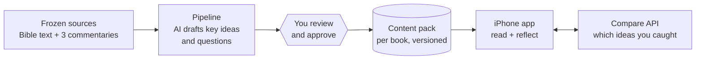
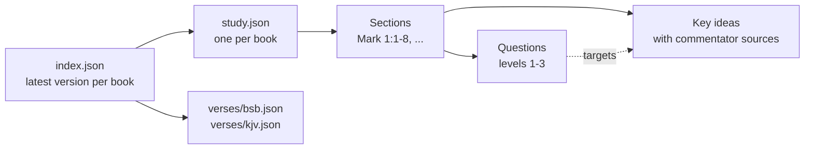
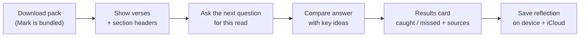

# Content flow: from frozen sources to the app

How study content is made (the batch pipeline, spec 001), what a content pack contains, and how
the iPhone app uses it (specs 002–004, planned). For stage-level detail, see
[`specs/001-content-pack-pipeline/`](../specs/001-content-pack-pipeline/). For example files,
see [`content/schema/fixtures/valid/`](../content/schema/fixtures/valid/).

## The big picture

- **Sources** are downloaded once and frozen. Nothing reads from the web after that.
- The **pipeline** drafts the study content for one book at a time. AI only summarises what the
  commentators say.
- **You** review the drafts and approve them before anything is published.
- A **content pack** is published per book and version, and the app downloads it and keeps it
  offline.
- The **app** compares a reader's answer with the pack's key ideas. That is the only live AI call.

## What's in a pack

- **`study.json`** is shared by every translation. **`verses/*.json`** holds the text, one file
  per translation.
- **IDs never change** (`mrk-1-1`, `mrk-1-1-k3`, `mrk-1-1-q4`). Weak items are retired, never
  deleted.
- The contract is the set of JSON Schemas in [`content/schema/`](../content/schema/).

## How the app uses it

- Reading and the results card work **offline** from the pack. Only the personal note needs the
  compare API.
- The compare API receives just the answer and two IDs. It never stores the answer.
- Each saved reflection keeps a copy of what was shown, so it stays complete after pack updates.
