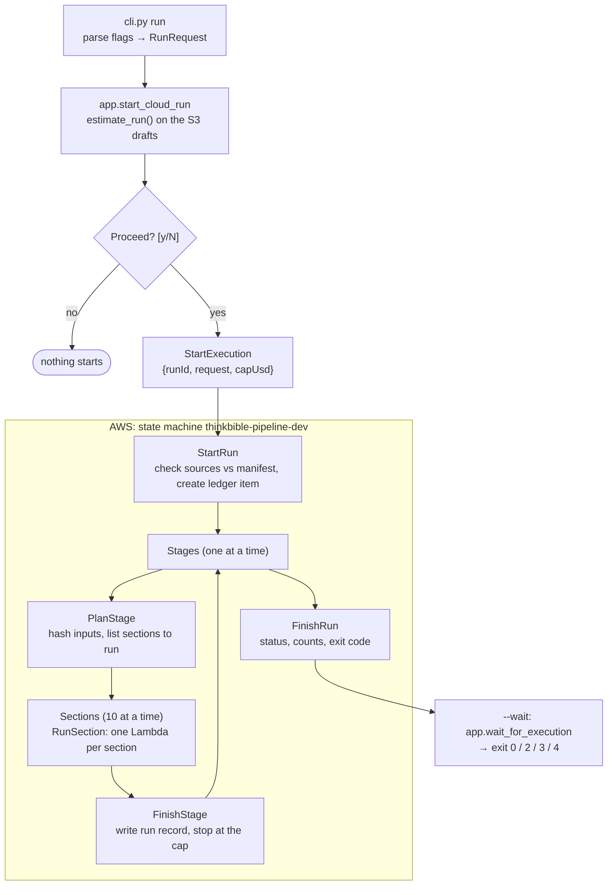
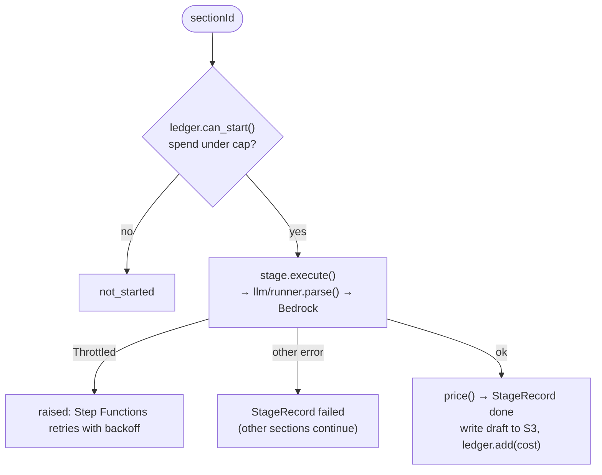

# `thinkbible_pipeline`

The batch content pipeline (spec 001). It turns the frozen source snapshot into versioned content
packs. Runs execute in AWS: a Step Functions state machine with one Lambda per section per stage.
The CLI on your machine estimates the cost, starts runs, and shows their status. Design docs:
[`specs/001-content-pack-pipeline/`](../../../specs/001-content-pack-pipeline/) (plan, research,
data model, [CLI contract](../../../specs/001-content-pack-pipeline/contracts/cli.md)). Area
rules: [`pipeline/CLAUDE.md`](../../CLAUDE.md).

## How a run flows



Every box inside AWS calls one shared step in `stages/base.py`. `run --local` calls the same
steps in-process (asyncio) for a few sections at a time, which is how prompts get tuned without
redeploying. Before the pipeline is deployed, `--local` keeps drafts in `content/drafts/`.

What one `RunSection` does:



## Files

### Entry and wiring

| File | What it does |
|---|---|
| `cli.py` | Thin Typer front door. `run` starts a cloud run (or `--local`), `status` shows runs and opens the scorecard; `publish`, `promote`, `calibrate`, `eval`, `import`, `sources` arrive with later tasks |
| `requests.py` | `RunRequest`, `PublishRequest`, `PromoteRequest`. The same JSON travels in the Step Functions execution input. Expands `all`, sorts stages into pipeline order |
| `app.py` | Composition root for the CLI: `local_deps`, `start_cloud_run` (estimate → confirm → `StartExecution`), `wait_for_execution`, and `draft_blobs` (S3 once deployed, `content/drafts/` before) |
| `exitcodes.py` | `ExitCode` 0–5, exactly as in the CLI contract |

### Running stages

| File | What it does |
|---|---|
| `stages/base.py` | The shared steps: `estimate_run`, `plan_stage` (hash and skip), `run_one_section` (cap check, execute, save, add cost), `finish_stage` (run record, cap stop), and `run()` for local mode. Defines `SectionStage`, `BookStage` and `Deps` |
| `stages/__init__.py` | `registry()`: stage name → implementation. Empty until US1 adds `sections`, `summaries`, `generate` and the rest |
| `ledger.py` | `SpendLedger`: the run's cap and spend. `InMemoryLedger` for local runs |
| `cloud/ledger.py` | `DynamoLedger`: the same ledger in DynamoDB, shared by every section Lambda (atomic `ADD`) |
| `cloud/handlers.py` | The five Lambda handlers: `start_run`, `plan_stage_handler`, `run_section`, `finish_stage_handler`, `finish_run` |
| `cloud/messages.py` | The JSON payloads between states (`RunInput`, `PlanOutput`, `SectionInput`, …) |

A stage implements four methods: `prompt_version()`, `model()`, `inputs()` (everything its output
depends on, as JSON-ready data) and `execute()` (does the work and updates the draft in place). The
runner does everything else, in the cloud and locally.

### Model calls (`llm/`)

| File | What it does |
|---|---|
| `llm/runner.py` | `BedrockRunner`: Claude in Amazon Bedrock through the Anthropic SDK's Mantle client, structured output, cached system prefix, effort per stage, refusal fallback to Opus, retries of invalid output, never any `tools`. Throttling raises `Throttled` so Step Functions retries. `FakeRunner` replays recorded outputs for tests |
| `llm/budget.py` | `price(usage)` from `pricing.toml`, `estimate()` (median cost per section over the last 20 runs, else the settings default), and the `Proceed? [y/N]` prompt |
| `llm/prompts.py` | Builds the system prompt: shared context, then the stage prompt, then (optionally) the question guide |

### Storage and data

| File | What it does |
|---|---|
| `storage.py` | `BlobStore`: `LocalBlobStore` (a folder) and `S3BlobStore`, with conditional writes |
| `drafts/models.py`, `drafts/store.py` | Draft entities (data-model §2) and `DraftStore`, which reads and writes `{book}/…` in a `BlobStore`. Run records are one object per stage run |
| `sources/models.py`, `sources/snapshot.py` | The source manifest and normalised books. `SourceStore` reads the local cache (by `file`) or the sources bucket (by `s3Key`); every read is checked against the manifest's sha256 |
| `jsonio.py`, `config.py`, `paths.py` | Canonical JSON and hashing; `settings.toml`, `pricing.toml` and `envs/{env}.toml`; repo paths (in a Lambda, `/var/task` is laid out like the repo) |

## Outside this package

| Path | What it is |
|---|---|
| `pipeline/config/` | `settings.toml` (model, effort, prompt version and default cost per stage; concurrency), `pricing.toml`, `envs/dev.toml` (buckets, ledger table, state machine ARN) |
| `pipeline/prompts/` | Versioned prompts (`{stage}/vN.md`). Never edit a version that has been used for a run |
| `pipeline/scripts/build_bundle.py` | `make lambda-bundle`: the Lambda zip (arm64, Python 3.12) with dependencies, both packages, config, prompts, schema and manifest |
| `infra/modules/pipeline/` | Terraform: drafts bucket, ledger table, the five Lambdas, the state machine (`state_machine.asl.json.tftpl`), IAM |
| `infra/envs/dev/` | The dev environment: the sources bucket and the pipeline |
| `pipeline/tests/` | Unit tests, plus integration tests on moto: storage, the DynamoDB ledger, the handlers driven through a whole run, and the CLI's cloud path |

## Deploying

```bash
make lambda-bundle
cd infra/envs/dev && terraform init && terraform apply
terraform output     # copy into pipeline/config/envs/dev.toml
```

Redeploy after code or prompt changes. `--local` runs use the repo's prompts directly.

## Rules the tests enforce

- Only `sources/importer.py` (US4) may import networking modules (`test_network_guard.py`).
- No model request carries `tools` (`test_no_tools.py`).
- The state machine calls exactly the five handlers, and Terraform allows exactly the models in
  `settings.toml` (`test_state_machine.py`, `test_infra_sync.py`).
- Tests never call models. They use `FakeRunner`.
