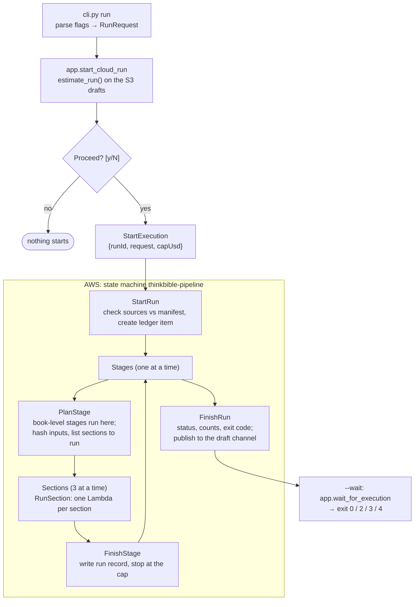
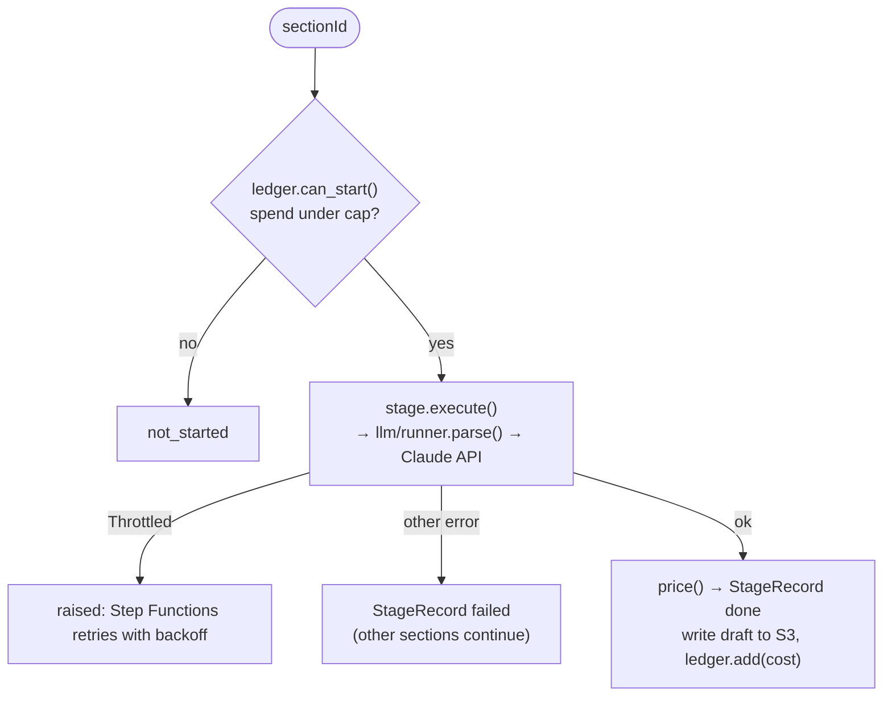

# `thinkbible_pipeline`

## About

The batch content pipeline behind ThinkBible (spec 001). It takes the frozen source snapshot (the
BSB and KJV texts and three public-domain commentaries) and, one book at a time, writes the study
content the app shows:
- sections;
- key ideas attributed to the commentators;
- up to three questions per section, in the order a reader meets them;
- context and "views differ" notes.

An automatic quality gate checks every item before a book is published.

Runs execute in AWS: a Step Functions state machine with one Lambda per section per stage, drafts
in S3 and a spend ledger in DynamoDB. The CLI on your machine shows the cost estimate, starts
runs, and reports their status. The same code also runs in-process (`run --local`) for a few
sections at a time while tuning prompts.

Design docs: [`specs/001-content-pack-pipeline/`](../../../specs/001-content-pack-pipeline/) (plan,
research, data model, [CLI contract](../../../specs/001-content-pack-pipeline/contracts/cli.md)).
Rules for agents working here: [`pipeline/CLAUDE.md`](../../CLAUDE.md).

## File structure

```text
pipeline/
├── CLAUDE.md                       # area rules: no network outside the importer, never tools, …
├── pyproject.toml                  # package thinkbible-pipeline; CLI script `thinkbible-pipeline`
├── config/
│   ├── settings.toml               # model, effort, prompt version, default cost per stage; concurrency
│   ├── pricing.toml                # USD per million tokens, per model
│   └── aws.toml                    # buckets, ledger table, state machine ARN (from `terraform output`)
├── prompts/
│   ├── _shared/context-v2.md       # opening text of every system prompt
│   ├── intro/v2.md                 # the book introduction ("About Mark")
│   ├── intro-review/v2.md          # the grader's rubric for the introduction
│   ├── summaries/v1.md             # one-line summary
│   ├── align/v1.md                 # a question worded for KJV readers
│   ├── extract/v18.md              # generate call 1: key ideas, context, views differ
│   ├── questions/v18.md            # generate call 2: candidate questions in reading order
│   ├── question-guide/v5.md        # quality rules + the owner's favorite questions
│   └── review/v14.md               # the grader's rubric + the owner's worked examples
├── scripts/
│   └── build_bundle.py             # `make lambda-bundle`: builds pipeline/out/lambda.zip
├── src/thinkbible_pipeline/
│   ├── README.md                   # this file
│   ├── __main__.py                 # `python -m thinkbible_pipeline`
│   ├── cli.py                      # Typer CLI: import, sources, verify, run, status, publish, promote, …
│   ├── app.py                      # wiring for the CLI: local deps, start a cloud run, wait for it
│   ├── requests.py                 # RunRequest / PublishRequest / PromoteRequest (CLI and cloud JSON)
│   ├── exitcodes.py                # exit codes 0–5 from the CLI contract
│   ├── config.py                   # loads config/*.toml into frozen dataclasses
│   ├── paths.py                    # repo paths (in a Lambda, /var/task is laid out like the repo)
│   ├── jsonio.py                   # canonical JSON, hashing, the camelCase base model
│   ├── text.py                     # text normalisation for quote and repeat matching
│   ├── storage.py                  # BlobStore: a local folder or S3, with conditional writes
│   ├── ledger.py                   # SpendLedger: a run's cap and spend (in memory for local runs)
│   ├── stages/
│   │   ├── base.py                 # shared steps: estimate, plan, run one section, finish; local run()
│   │   ├── sections.py             # `sections`: writes the book's section map (no model calls)
│   │   ├── intro.py                # `intro`: the book introduction, once per book (first section)
│   │   ├── summaries.py            # `summaries`: one line per section (Haiku)
│   │   ├── generate.py             # `generate`: key ideas, context, questions (Sonnet)
│   │   ├── generate_rules.py       # evidence check, ranking, choosing questions (no model calls)
│   │   ├── align.py                # `align`: KJV wording variants and manuscript notes (Haiku)
│   │   ├── align_rules.py          # what needs a variant or a note (no model calls)
│   │   ├── checks.py               # `check`: the gate's rule checks on each finished section
│   │   ├── review.py               # `review`: the grader (Opus) grades every item 1-5
│   │   ├── report.py               # `report`: scorecard.json + review.html for the book
│   │   └── __init__.py             # registry() of stage implementations
│   ├── sections/
│   │   ├── builder.py              # BSB headings + Henry's divisions → 3-12 verse sections (R5)
│   │   └── passage.py              # a section's verses as prompt text
│   ├── gate/
│   │   ├── checks.py               # rule checks: lengths, "?", yes/no, giveaways, names, placeholders
│   │   ├── outcomes.py             # drop items and what depends on them, flag a section for regeneration
│   │   └── calibration.py          # your pass/fail grades vs the grader's (evals/calibration.json)
│   ├── publish/
│   │   ├── build.py                # drafts + snapshot → study pack and verse files, versioned (R13)
│   │   ├── publish_check.py        # live content only grows: nothing reworded or removed (FR-024)
│   │   ├── channel.py              # the draft/ and live/ channels of the packs bucket, behind CloudFront
│   │   ├── draft.py                # publish to the draft channel (automatic after a passing run)
│   │   └── promote.py              # copy the draft version byte for byte to live, gated
│   ├── report/
│   │   ├── scorecard.py            # the book's numbers: kept, dropped, failed, cost
│   │   ├── render.py               # review.html (Jinja2): every section, its ideas and questions
│   │   └── templates/review.html.j2
│   ├── commentary/
│   │   ├── crossrefs.py            # "See on Mt 4:1-11", "( = Lu …)": pointers to another note
│   │   ├── preface.py              # each commentator's book preface, split from their first note
│   │   └── gather.py               # each commentator's excerpt for a section (R4)
│   ├── cloud/
│   │   ├── handlers.py             # the five Lambda handlers the state machine calls
│   │   ├── messages.py             # JSON payloads between the state machine's steps
│   │   └── ledger.py               # DynamoLedger: the spend ledger in DynamoDB
│   ├── llm/
│   │   ├── runner.py               # the model runner (Claude API by default; Bedrock as a profile) and FakeRunner (tests)
│   │   ├── budget.py               # pricing, cost estimate, the Proceed? [y/N] prompt
│   │   ├── outputs.py              # what each model call must return (structured output)
│   │   └── prompts.py              # assembles the versioned system prompt for a stage
│   ├── drafts/
│   │   ├── models.py               # BookState, SectionDraft, RunRecord, … (data-model §2)
│   │   ├── live.py                 # live content is frozen: the guard and the frozen-wording check
│   │   ├── retire.py               # `retire`: retire an item, optionally with a replacement
│   │   ├── ids.py                  # permanent key-idea and question IDs, never reused
│   │   └── store.py                # DraftStore: reads and writes {book}/… in a BlobStore
│   └── sources/
│       ├── models.py               # source manifest and normalised book formats (data-model §3)
│       ├── importer.py             # `import`: the ONLY network code; fetches the five sources once
│       ├── normalize.py            # HelloAO chapter JSON → normalised translation books
│       ├── sword.py                # CrossWire module zip → normalised commentary books (offline)
│       ├── refs.py                 # tagged Scripture references → "MAT 12:9-21"
│       ├── versification.py        # KJV verses per chapter (1,189 chapters, 31,102 verses)
│       ├── check.py                # `sources check`: complete and in place?
│       ├── snapshot.py             # reads source files and checks each against the manifest
│       └── store.py                # `sources push` / `sources pull`: cache ↔ write-once S3 bucket
└── tests/
    ├── unit/                       # runner, budget, requests, state machine, bundle, guards
    ├── integration/                # on moto: storage, DynamoDB ledger, handlers, CLI cloud path
    └── fixtures/                   # trimmed API responses (api/) and recorded model outputs

infra/modules/pipeline/             # Terraform for the cloud side
├── main.tf                         # drafts bucket, ledger table, the five Lambdas, the state machine
├── iam.tf                          # least-privilege roles for the Lambdas and Step Functions
├── state_machine.asl.json.tftpl    # the state machine definition (a Terraform template)
├── variables.tf
└── outputs.tf                      # values to copy into config/aws.toml
infra/modules/cdn/                  # CloudFront in front of the packs bucket (origin access control)
```

## How a run flows



### The two Map states

The state machine (`infra/modules/pipeline/state_machine.asl.json.tftpl`) has two Map states, one
inside the other. Steps pass only small JSON messages (run ID, request, cap, stage, section ID,
costs); a section's content never travels through Step Functions. Each Lambda reads and writes
drafts in S3.

- **`Stages`** iterates over `$.request.stages`: the stages named on the command line (`all`
  expands to the eight below). One at a time and in order, because each stage needs the one
  before finished for the whole book (a section's context uses the previous section's summary;
  the grader needs the generated content). For each stage:
  1. **`PlanStage`** (Lambda) returns the stage's `sectionIds`: each section whose inputs, prompt
     version or model changed since the stage last ran there. Done sections are skipped, so a
     re-run pays only for what changed. A stage that applies to some sections only lists those
     (`intro`: the book's first). A book-level stage (`sections`, `report`) runs right here and
     lists none. After the cap is reached, it lists none.
  2. **`Sections`** iterates over `$.sectionIds`, `max_concurrency` (3) at a time, one
     **`RunSection`** Lambda per section (below). A throttled Claude API call raises `Throttled`,
     and Step Functions retries after 20 s, doubling to at most 5 minutes, up to 6 times, with
     jitter. Any other error records the section as failed; the rest carry on.
  3. **`FinishStage`** (Lambda) totals the outcomes (done, skipped, failed, cost) into the stage's
     result and stops the run once spend reaches the cap.
- **`FinishRun`** records the final status. When the run included `report` and no section
  failed, it publishes the book to the draft channel (`publish/draft.py`); a book with sections
  still to generate is reported and left for a later run. Its output is what `--wait` prints.

### The stages, in run order

| Stage | Runs | Model | Cost | What it does |
|---|---|---|---|---|
| `sections` | once per book, in `PlanStage` | none | free | Splits the book into 3-12 verse sections (`sections/builder.py`, R5): each BSB heading starts one, never across chapters; a 1-2 verse piece joins the passage it finishes; a long one splits at Henry's division nearest the middle. IDs come from the first verse (`mrk-2-18`) and are permanent once live. Writes `sections.json`. |
| `intro` | the book's first section | Sonnet writes, Opus grades | about $0.15 per book | "About Mark", the book's first post: 80-120 words from each commentator's preface (who wrote it, to whom, when, why, what to watch for), each source backed by an exact quote. Graded 2 or less: one rewrite with the reason; still failing, a scorecard blocker. |
| `summaries` | every section | Haiku | about $0.002 | One line about the passage. The next section's `generate` gets it as "the previous section", for its context note's "how this follows". Questions are never written from it. |
| `generate` | every section | Sonnet | about $0.10 | The content. Code gathers each commentator's notes on the section (`commentary/gather.py`, R4; notes running past the section are labelled so). Call 1 writes the key ideas (one marked as the central meaning) and background facts, each source with an exact quote, plus the context and "views differ" notes. Code keeps only sources whose quote is found word for word. Call 2 writes up to 10 candidate questions in reading order, 2-3 on the central idea. Code checks each one (length, "?", in the section's verses, aimed at a key idea). |
| `align` | every section | Haiku, only where needed | about $0.0001 | For KJV readers: a question that quotes a phrase the KJV words differently ('I am willing' / 'I will') or names someone the KJV spells differently (Elijah / Elias) gets a KJV wording (`textByTranslation.kjv`); the question itself is unchanged. Code also writes neutral manuscript notes for verses one translation has and the other doesn't (Mark 7:16) and for early endings (after Mark 16:8). |
| `check` | every section | none | free | The published format's rules on the finished section: lengths, verse references that resolve in both translations, no cut-off text. A section that breaks one is regenerated on the next run, once; then it fails. |
| `review` | every section | Opus | about $0.13 | The quality gate: the calibrated grader scores every key idea, candidate question and note 1-5. At 2 or less an item is dropped. Up to 3 questions are kept (never more than the key ideas): the best on the central idea first if it grades 4 or more, then the best of the rest. A weak views note is removed; a weak context note regenerates the section. |
| `report` | once per book, in `PlanStage` | none | free | `scorecard.json` (pass rates, failed and ungenerated sections, calibration, cost, what blocks promotion) and `review.html` (`make status` opens it), and the book's status. |

In all, about $0.27 per section.

### One `RunSection`

Every step inside AWS calls one shared function in `stages/base.py`. `run --local` calls the same
functions in-process. What one `RunSection` does:



Things to know:
- **Unchanged work is skipped.** Each stage hashes everything a section's output depends on (its
  inputs, the prompt version and the model). If the hash matches the last successful run, the
  section is skipped. Re-running an unchanged book makes no model calls; `--fresh` forces it.
- **One bad section doesn't stop the book.** It's recorded as failed, the rest carry on, and the
  next run retries it.
- **Spend has a cap,** by default twice the estimate. Once spend reaches it, no new section starts;
  sections already running finish.

## Freezing the sources (once)

| Source | Upstream | How |
|---|---|---|
| BSB, KJV | Free Use Bible API (HelloAO) | one JSON request per chapter (~25 min) |
| Matthew Henry, JFB, Adam Clarke | CrossWire SWORD modules MHC, JFB, Clarke (public domain, from CCEL and Wikisource) | one zip per commentary, read offline by `sword.py` |

HelloAO also serves commentaries, but theirs were hand-copied and have shifted and missing
chapters, so the commentaries come from CrossWire (research R2a).

Two steps, with `AWS_PROFILE=admin-thinkbible` set and the infrastructure deployed:

```bash
uv run --package thinkbible-pipeline thinkbible-pipeline import --all   # saves after every book; a re-run resumes
make sources-publish                    # check, verify, push, then verify what's in S3
```

`make sources-publish` runs these in order and stops at the first failure:

| Step | Command | Proves |
|---|---|---|
| 1 | `sources check` | The cache is complete and in place (versification, order, coverage) |
| 2 | `verify` | Every cached file matches `content/sources/manifest.json` |
| 3 | `sources push` | Uploads what S3 doesn't have yet (write-once; safe to re-run) |
| 4 | `verify --remote` | Downloads every file from the sources bucket and checks it against the manifest |

It never moves or changes the local cache. Commit `content/sources/manifest.json` once it
passes. `sources push` on its own uploads only what's missing, so re-running it after a
partial upload is safe.

- **Nothing upstream can break the snapshot later.** Each file is checksummed and stored
  write-once. Each commentary's module zip is archived next to its books, so re-runs (and parser
  fixes, with `--refresh`) never need CrossWire again.
- **Each source records its edition** as `origin` (`helloao:BSB`, `crosswire:JFB@3.0/reader2`).
  Importing a new edition, or changing how `sword.py` reads modules (`READER_VERSION`),
  re-imports all of that source's books, from the archived zips.
- `verify` proves files haven't changed since import; `sources check` proves they were right to
  begin with.

Commit only `content/sources/manifest.json`. On a new machine, `sources pull` restores the cache.
`import` is the only command that fetches text from the web, and it isn't run again unless a
source is deliberately added (constitution II).

### Restoring, re-checking and redeploying

Everything here is safe to re-run. `…` stands for
`uv run --package thinkbible-pipeline thinkbible-pipeline`.

| Situation | Run |
|---|---|
| New machine, or the local cache was deleted | `make sources-pull`: downloads the snapshot from S3 and checks each file against the manifest |
| Check that everything is still right | `make sources-publish`: with nothing new, the push uploads 0 files and the other steps re-check the cache and S3 |
| Check only S3, or only the cache | `… verify --remote`, or `… verify` and `… sources check` |
| Changed pipeline code, config or prompts | `make deploy`: rebuilds the Lambda bundle and runs `terraform apply` |
| Add a source, or move to a new edition of one (rare) | `… import --all --sources <source>` (add `--refresh` to redo existing books), then `make sources-publish`, then commit `content/sources/manifest.json` |

- Every command needs `export AWS_PROFILE=admin-thinkbible` (and `aws sso login` if the session
  has expired), except `import`, `sources check` and plain `verify`.
- A re-import writes new files under that day's date in S3. Existing objects are never
  overwritten, so if you re-import a source on the same day as an earlier push and the content
  comes out different, `sources push` refuses. Re-import the next day instead.

## Running it

```bash
make pipeline BOOK=mark STAGE=all       # in AWS: estimate, confirm, start, wait for the result
make status BOOK=mark                   # latest runs, spend, and opens the scorecard (review.html)
make publish BOOK=mark                  # publish to the draft channel (a passing run does this itself)
make promote BOOK=mark                  # copy the draft version to live, if the gate allows it
```

Once a book is live its wording is frozen (FR-024): content stages skip live sections, and the gate
only reports on them. To fix or improve a live item, retire it and give the replacement's wording;
to add questions to a live section, refresh it:

```bash
uv run --package thinkbible-pipeline thinkbible-pipeline retire --book mark --item mrk-1-1-q5 \
  --replace --text "The new wording of the question?"
uv run --package thinkbible-pipeline thinkbible-pipeline run --book mark --stage all --refresh
uv run --package thinkbible-pipeline thinkbible-pipeline run --book mark --stage generate \
  --local --sections mrk-1-1,mrk-1-9    # in-process, two sections, using the repo's prompts
```

Before the pipeline is deployed, `run` says so and points you to `--local`, which then keeps
drafts in `content/drafts/` instead of S3.

To see exactly what the model will be given for a section (each commentator's notes, the
introduction blocks and the parallel passage notes it follows), with no model call:

```bash
uv run --package thinkbible-pipeline thinkbible-pipeline excerpts --book mark --section mrk-1-12
#   --commentator jamieson-fausset-brown   only one commentator;  --full   every part in full
```

## Deploying

```bash
export AWS_PROFILE=admin-thinkbible
make deploy                                     # make lambda-bundle, then terraform apply in infra/
terraform -chdir=infra output                   # first time: copy into pipeline/config/aws.toml
```

The first time on a machine, run `terraform -chdir=infra init` before `make deploy`.

Rebuild and re-apply after any change to pipeline code, config or prompts. The Lambdas only see
what was in the zip. `--local` runs read the repo directly, which is why they're the fast way to
tune prompts.

### What `make lambda-bundle` does

It runs `pipeline/scripts/build_bundle.py`, which builds `pipeline/out/lambda.zip` (about 25 MB,
gitignored):

1. **Lists the dependencies.** It exports the exact locked versions the pipeline uses from
   `uv.lock` (`anthropic`, `pydantic`, `boto3`, …), without dev tools.
2. **Downloads Lambda's builds of them.** The Lambdas run Linux on ARM (arm64, Python 3.12), not
   macOS. Packages with compiled code, such as `pydantic-core`, are fetched as Linux arm64 wheels.
3. **Adds our code:** the `thinkbible_core` and `thinkbible_pipeline` packages.
4. **Adds the files the code reads at runtime,** laid out like the repo so the code finds them the
   same way it does locally:
   - `pipeline/config/` and `pipeline/prompts/`;
   - `content/schema/`, the content pack contract;
   - `content/sources/manifest.json`, the source checksums (from US4; until then the build warns
     that it's missing);
   - `pipeline/evals/`, the grader calibration set (from US2).
5. **Writes `BUILD_INFO.json`** with the git commit it was built from. Every run record stores it
   as `codeVersion`, so you can tell which code produced a draft. There's deliberately no build
   timestamp: the same commit gives a byte-identical zip, so `terraform apply` only redeploys the
   Lambdas when the code changed.
6. **Zips it** and fails if the zip is over 50 MB, Lambda's limit for a direct upload.

The five Lambdas share this one zip; each starts at a different handler in `cloud/handlers.py`.
`terraform apply` uploads it to all five when it changed.

## Writing a stage

A stage implements four methods; the runner does the rest, in the cloud and locally:

| Method | What it returns |
|---|---|
| `prompt_version()` | The prompt version it uses (recorded and hashed) |
| `model()` | The model ID it calls (from `settings.toml`), or `None` if it calls no model |
| `inputs()` | Everything its output depends on, as JSON-ready data. Hashed to decide skips |
| `execute()` | Does the work, updates the section's draft in place, and returns the token usage |

Whole-book stages (`sections`, `report`) subclass `BookStage` and implement `run_book()` instead.
Register a stage in `stages/__init__.py`.

## Rules the tests enforce

- Only `sources/importer.py` (US4) may import networking modules (`test_network_guard.py`).
- No model request carries `tools` (`test_no_tools.py`).
- The state machine calls exactly the five handlers (`test_state_machine.py`).
- Terraform allows exactly the models and concurrency in `settings.toml` (`test_infra_sync.py`).
- Tests never call models. They use `FakeRunner`, and AWS is mocked with moto.
