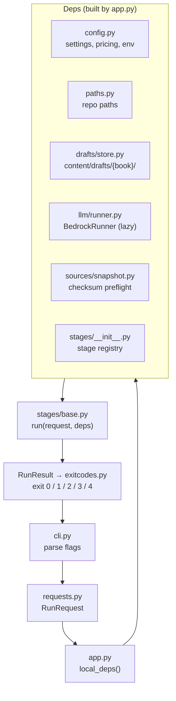
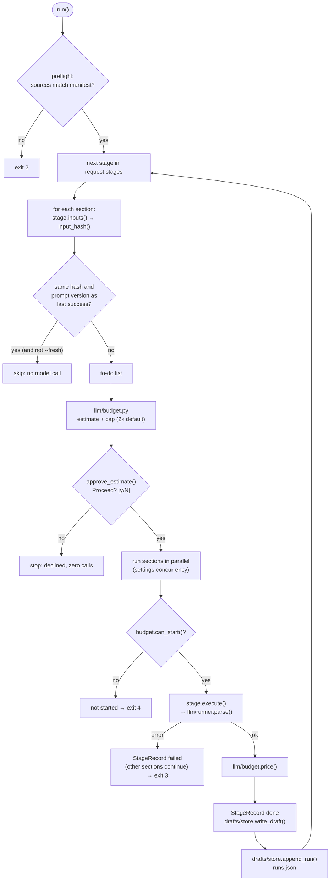

# `thinkbible_pipeline`

The batch content pipeline (spec 001). It turns the frozen source snapshot into reviewed,
versioned content packs. Design docs: [`specs/001-content-pack-pipeline/`](../../../specs/001-content-pack-pipeline/)
(plan, research, data model, [CLI contract](../../../specs/001-content-pack-pipeline/contracts/cli.md)).
Area rules: [`pipeline/CLAUDE.md`](../../CLAUDE.md).

## How a run flows

The entry point is **`cli.py`**: the `thinkbible-pipeline` command runs its Typer `app`.
`app.py` is not the entry point. It's where the CLI gets its real dependencies.

Inside `stages/base.run`, each stage goes through the same steps:

## Files

### Entry and wiring

| File | What it does |
|---|---|
| `cli.py` | Thin Typer front door. Parses flags into a request object, calls shared code, maps the result to an exit code. No pipeline logic. Commands from later phases print "not implemented yet" |
| `requests.py` | `RunRequest`, `PublishRequest`, `ApproveRequest`. A future cloud trigger sends the same thing as JSON (`{"book":"mark","stages":["all"],"capUsd":20}`). Expands `all`, sorts stages into pipeline order, rejects unknown books and stages. Also holds `STAGE_ORDER` and `MODEL_STAGES` |
| `app.py` | Composition root for local runs: settings, pricing, the draft store, the Bedrock runner (created only when a stage needs it), the `Proceed? [y/N]` prompt and the source checksum preflight. A cloud runner builds its own `Deps` and calls the same `run()` |
| `exitcodes.py` | `ExitCode` 0–5, exactly as in the CLI contract |

### Stage runner (`stages/`)

| File | What it does |
|---|---|
| `stages/base.py` | `run(request, deps) -> RunResult`. Hashes each section's inputs with the prompt version and model and skips unchanged sections, so a re-run makes zero model calls. Shows the estimate and waits for approval, runs sections in parallel, stops starting new ones at the spend cap, isolates failures to one section, records a `StageRecord` per section and a `RunRecord` per stage. Defines the `SectionStage` and `BookStage` base classes and `Deps` |
| `stages/__init__.py` | `registry()`: stage name → implementation. Empty until US1 adds `sections`, `summaries`, `generate` and the rest |

A stage implements four methods: `prompt_version()`, `model()`, `inputs()` (everything its output
depends on, as JSON-ready data) and `execute()` (does the work and updates the draft in place). The
runner does everything else.

### Model calls (`llm/`)

| File | What it does |
|---|---|
| `llm/runner.py` | `ModelRunner` protocol. `BedrockRunner` calls Claude in Amazon Bedrock through the Anthropic SDK (`AsyncAnthropicBedrockMantle`, `beta.messages.parse` with a Pydantic output model). It caches the stable system prefix, sets effort per stage, retries a refusal once on Opus (`BetaRefusalFallbackMiddleware`), retries invalid output up to 2 times, and refuses any request that carries `tools`. `FakeRunner` replays recorded outputs for tests |
| `llm/budget.py` | `price(usage)` from `pricing.toml`. `estimate()`: median cost per section over the last 20 runs, else the settings default. `Budget(cap)`, and `confirm()` for the prompt |
| `llm/prompts.py` | Builds the system prompt: shared context, then the stage prompt, then (optionally) the question guide. Returns their versions for the run record |

### Data and storage

| File | What it does |
|---|---|
| `drafts/models.py` | Draft entities (data-model §2): `BookState`, `SectionMapEntry`, `SectionDraft`, `StageRecord`, `RunRecord`, `Approval`, flags, checks, grades |
| `drafts/store.py` | `DraftStore`: reads and writes `content/drafts/{book}/` (`book.json`, `sections.json`, `sections/{id}.json`, `.generated/{id}.json`, `runs.json`, `approval.json`) |
| `sources/models.py` | `SourceManifest` and the normalised translation and commentary book formats (data-model §3) |
| `sources/snapshot.py` | `load_book()` checks a cache file's sha256 against the manifest before parsing it. `verify()` checks them all. Raises `ChecksumMismatch` / `MissingSource` (exit 2) |
| `jsonio.py` | `JsonModel` base (camelCase JSON, snake_case Python). Canonical JSON writing (sorted keys, 2-space indent, atomic), hashing |
| `config.py` | Loads `pipeline/config/settings.toml`, `pricing.toml` and `envs/{env}.toml` into frozen dataclasses |
| `paths.py` | `RepoPaths`: every content, config and prompt path from the repo root. Tests point it at a temp folder |

## Outside this package

| Path | What it is |
|---|---|
| `pipeline/config/settings.toml` | Model, effort, prompt version and default cost per stage; concurrency; refusal fallback model |
| `pipeline/config/pricing.toml` | Bedrock USD per million tokens, per model |
| `pipeline/config/envs/dev.toml` | Dev bucket names and CloudFront values |
| `pipeline/prompts/` | Versioned prompts (`{stage}/vN.md`). Never edit a version that has been used for a run; add `vN+1.md` |
| `pipeline/tests/unit/` | `test_stage_runner.py`, `test_budget.py`, `test_requests.py`, `test_no_tools.py`, `test_network_guard.py` |
| `content/drafts/{book}/` | Local draft store for tests and early runs. Moving to S3 in Phase 2b (T087); drafts are pipeline state, not hand-edited |

## Rules the tests enforce

- Only `sources/importer.py` (US4) may import networking modules (`test_network_guard.py`).
- No model request carries `tools` (`test_no_tools.py`).
- Tests never call models. They use `FakeRunner`.
